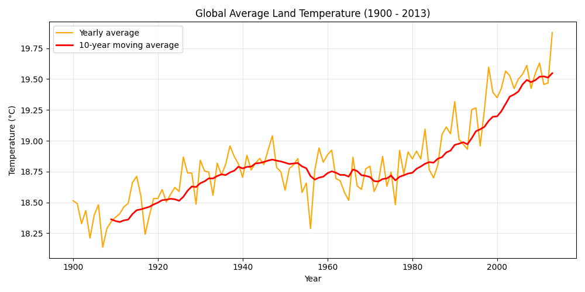
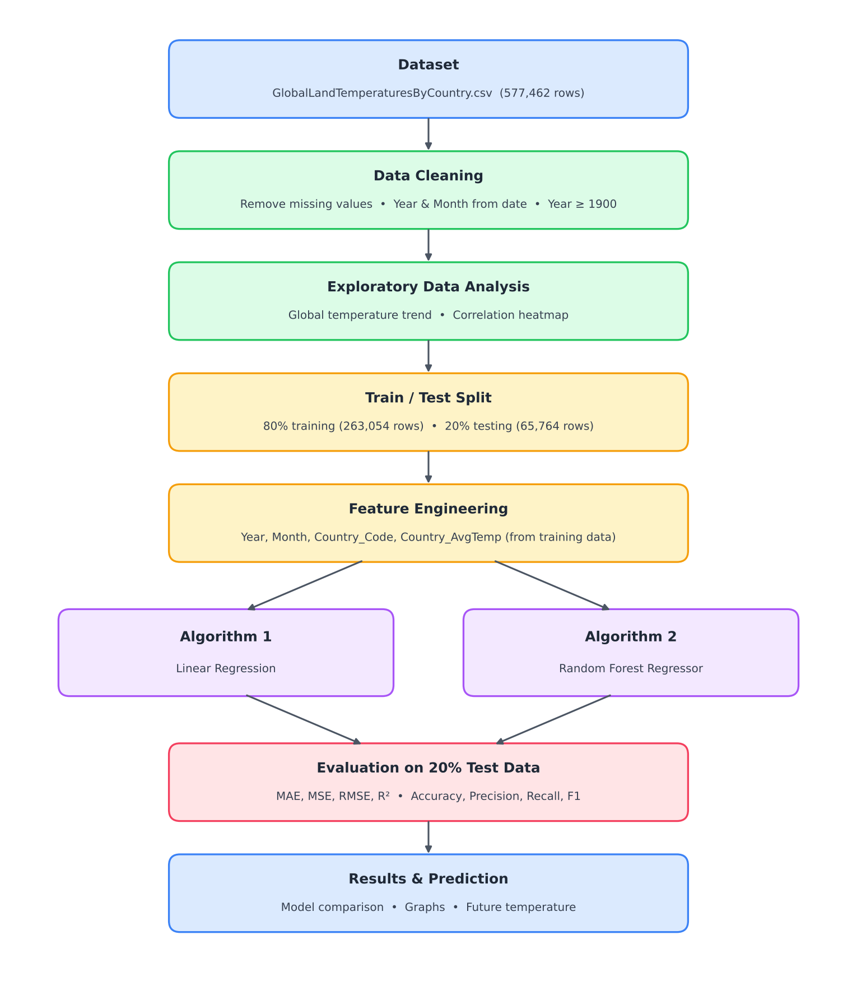
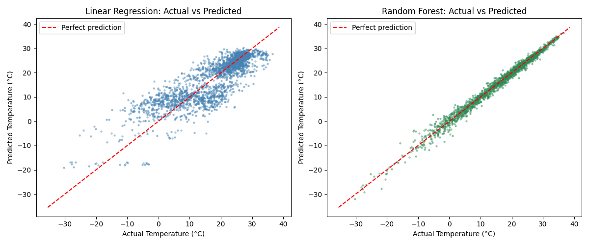
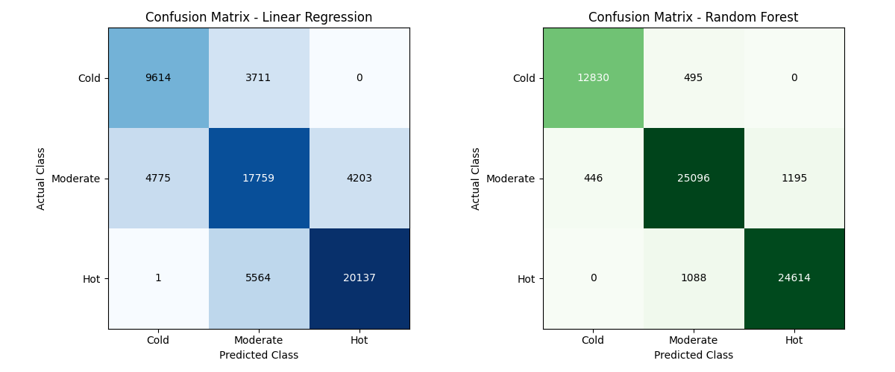
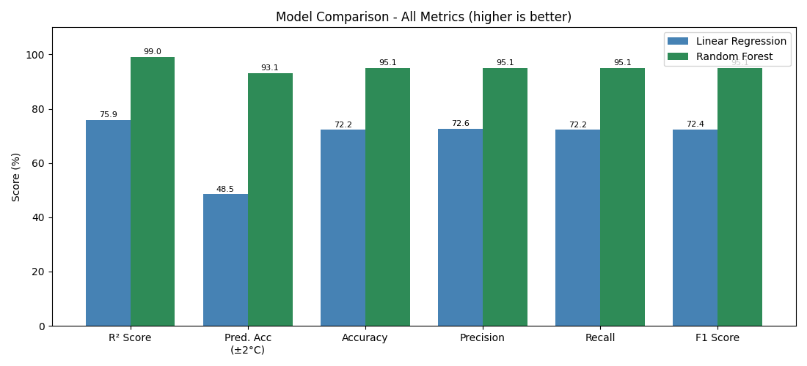
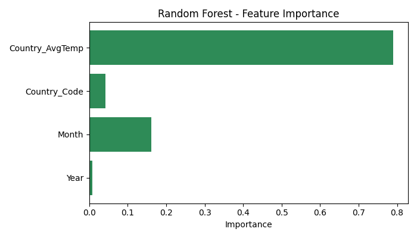

# Global Warming Prediction Using Climate Data

A Data Science & Analytics mini project that predicts the **average monthly land temperature** of 242 countries from historical climate data. It compares two machine learning algorithms, **Linear Regression** and **Random Forest Regressor**, trained on 80% of the data and tested on the remaining 20%.



## Highlights

- **577,462** records in the dataset, **328,818** used after cleaning (1900–2013, 242 countries)
- **Random Forest** reached an R² of **0.99**, an average error of **0.69 °C** and an F1 score of **95.1%**
- **Linear Regression** measured a warming trend of about **1.03 °C every 100 years**
- The 10-year average land temperature rose by about **1.1 °C** between the 1910s and 2013

## Dataset

**Climate Change: Earth Surface Temperature Data** by Berkeley Earth, on Kaggle:
https://www.kaggle.com/datasets/berkeleyearth/climate-change-earth-surface-temperature-data

Only one file is used: `GlobalLandTemperaturesByCountry.csv`. It is not included in this repository because of its size. Download it from Kaggle and place it next to the Python file.

| Column | Meaning |
|---|---|
| `dt` | Month of the record (1743–2013) |
| `AverageTemperature` | Average land temperature for that month, in °C (target) |
| `AverageTemperatureUncertainty` | 95% confidence range of the reading |
| `Country` | Country or region name |

## Workflow



1. **Load** the CSV with pandas and print its info, missing values and summary statistics
2. **Clean**: remove rows with missing temperature, extract Year and Month, keep data from 1900 onwards, encode country names as numbers
3. **Explore**: global temperature trend and correlation heatmap
4. **Split**: 80% training, 20% testing (`random_state=42`); each country's average temperature is computed from the training data only
5. **Train** Linear Regression and Random Forest (50 trees, max depth 20) on the same training data
6. **Evaluate** both on the same unseen test data
7. **Visualise** results and **predict** future temperatures for a chosen country

**Features:** `Year`, `Month`, `Country_Code`, `Country_AvgTemp` → **Target:** `AverageTemperature`

## Why these two algorithms?

| | Linear Regression | Random Forest |
|---|---|---|
| Role | Simple, interpretable baseline | Powerful ensemble model |
| Why | Warming is a slow, near-linear trend; the Year coefficient gives the warming rate; it can extrapolate to future years | Temperature depends on season and location in a non-linear way; averaging many trees reduces overfitting; handles large data and shows feature importance |
| Limitation | Cannot capture seasonal and regional patterns | Cannot predict beyond the last year in the training data (2013) |

## Results (20% test data, 65,764 records)

| Metric | Linear Regression | Random Forest |
|---|---|---|
| MAE | 3.645 °C | **0.692 °C** |
| MSE | 27.047 | **1.145** |
| RMSE | 5.201 °C | **1.070 °C** |
| R² score | 0.7587 | **0.9898** |
| Prediction accuracy (±2 °C) | 48.46% | **93.15%** |
| Accuracy | 72.24% | **95.10%** |
| Precision | 72.58% | **95.10%** |
| Recall | 72.24% | **95.10%** |
| F1 score | 72.37% | **95.10%** |

Accuracy, precision, recall and F1 score are computed by grouping temperatures into **Cold (< 10 °C)**, **Moderate (10–25 °C)** and **Hot (> 25 °C)**. Precision, recall and F1 are weighted averages over the three classes.

| Actual vs predicted | Confusion matrices |
|---|---|
|  |  |

| Model comparison | Feature importance |
|---|---|
|  |  |

### Future prediction for India

| Year | Linear Regression | Random Forest |
|---|---|---|
| 2020 | 24.78 °C | 24.60 °C |
| 2030 | 24.89 °C | 24.60 °C |
| 2050 | 25.09 °C | 24.60 °C |

Random Forest stays flat because tree-based models cannot extrapolate beyond the training years. Linear Regression is the better choice for long-term trends.

The full console output of a run is in [`results/sample_output.txt`](results/sample_output.txt).

## How to run

```bash
pip install -r requirements.txt
python global_warming_prediction.py
```

Or open `global_warming_prediction.py` in **Thonny** and press **F5**. Random Forest training takes about 1–3 minutes. The program saves 7 graphs as PNG files and the comparison table as `model_comparison_results.csv` in the same folder.

To predict for another country, change `country = "India"` near the end of the script.

## Project structure

```
global-warming-prediction/
├── global_warming_prediction.py   # complete program
├── requirements.txt
├── images/                        # graphs and diagrams
└── results/
    ├── model_comparison_results.csv
    └── sample_output.txt
```

## Tech stack

Python 3 · pandas · NumPy · scikit-learn · matplotlib · Thonny IDE

## Future scope

- Add causes of warming such as CO₂ emissions, population and forest cover
- Use newer data from NASA GISTEMP or FAOSTAT
- Try time-series models (ARIMA, Prophet, LSTM) and XGBoost
- Build an interactive dashboard to explore any country's forecast

## Acknowledgments

Dataset by [Berkeley Earth](https://berkeleyearth.org/data/). Project done under the guidance of Prof. Sahaya Jespa, Department of Computer Engineering, ST. Xavier's Technical Institute, Mahim.
